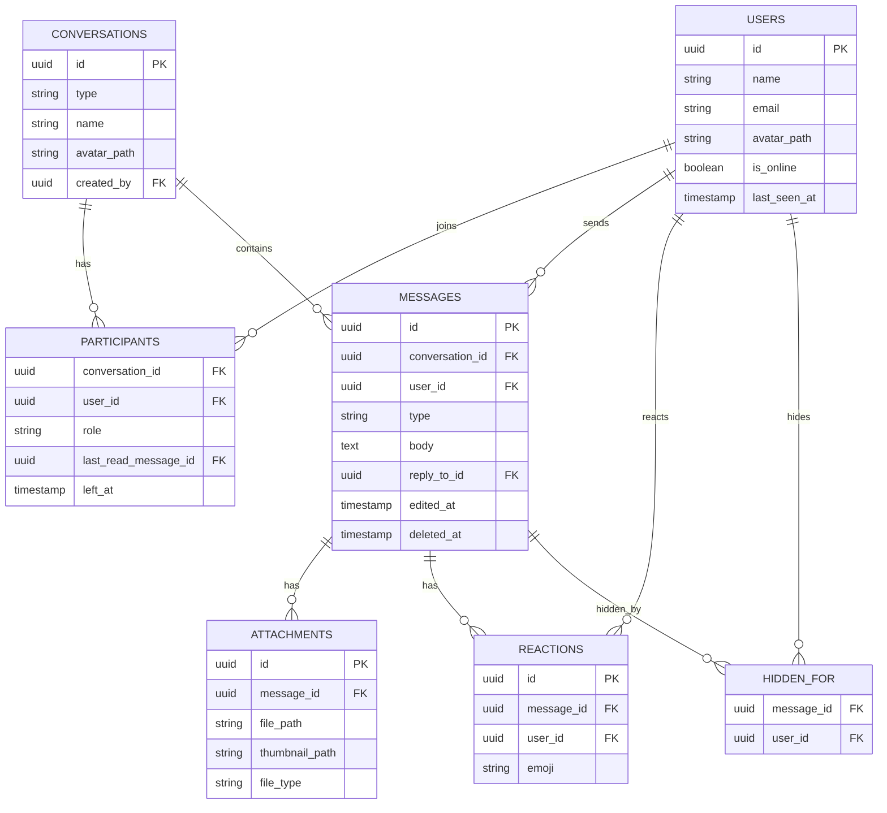

# Messenger API

A real-time messaging backend built with **Laravel 13**. It supports 1-to-1 and group conversations, text/image/file/voice messages, reactions, read receipts, typing indicators, and live online presence, delivered over WebSockets with **Laravel Reverb**.

> **Status:** the backend API is feature-complete for its first scope. A React client is planned. Every endpoint, including the negative authorization cases, has been verified manually with an API client; automated tests are on the roadmap (see [Roadmap](#roadmap-and-known-limitations)).

## Features

**Messaging**
- 1-to-1 and group conversations (a 1-to-1 between the same two people is reused, never duplicated)
- Text, image, file, and voice-note messages, with optional captions on images and files
- Replies, edits (with an `edited_at` marker), delete for everyone, and delete for me
- Emoji reactions, toggled on and off with a single endpoint
- Conversation search by group name or by the other participant's name

**Real-time (Laravel Reverb)**
- Live delivery of new, edited, and deleted messages and of reactions
- Typing indicators
- Per-user read receipts and live unread counts
- Online / last-seen presence

**Groups**
- Admin and member roles, rename, group avatar, add and remove members, leave
- Membership changes take effect immediately, including for open WebSocket connections

**Media and accounts**
- Private file storage served through time-limited signed URLs
- Server-generated image thumbnails
- Public, resized avatars for users and groups

**Security and limits**
- Sanctum cookie-based SPA authentication with CSRF protection
- Laravel Policies for every protected action
- Per-user rate limiting on sending, typing, and presence endpoints

## Tech stack

| Area | Choice |
|---|---|
| Framework | Laravel 13, PHP 8.3+ |
| Database | MySQL (UUIDv7 primary keys) |
| Auth | Laravel Sanctum (cookie / SPA mode) |
| Real-time | Laravel Reverb (WebSockets, Pusher protocol) |
| Queue and scheduler | Database queue, Laravel scheduler |
| Images | Intervention Image 4 (GD driver) |

## Architecture and design decisions

**One private channel per user, not per conversation.** Every client subscribes once to `user.{id}`. When something happens, the server works out who should hear about it by querying the conversation's *active* participants at that moment (`left_at IS NULL`), then broadcasts to those users' channels. Channel authorization only runs when a socket subscribes, so with per-conversation channels a removed member would keep receiving messages until they reconnected. Computing recipients per event means removal and re-adding take effect on the very next event. It also means one subscription covers every conversation, which is what makes live unread badges practical.

**Read receipts use a pointer, not a row per message.** Each participant stores `last_read_message_id`. A message is read by someone if its id is at or below their pointer, so a read receipt costs one row per participant rather than one per message per participant. The pointer only moves forward, enforced with an atomic conditional `UPDATE`, so a late request carrying an older id cannot move it back. Unread counts are computed from the same pointer in a single query for the whole conversation list.

**Time-ordered ids.** Models use UUIDv7, so ids are unique, non-guessable, and sort chronologically. Messages are ordered and paginated by id with cursor pagination, which avoids the skipped or repeated rows that sorting by a one-second `created_at` can produce.

**Authorization at every layer.**
- HTTP actions go through Policies (`ConversationPolicy`, `MessagePolicy`). Non-members get a `404` rather than a `403` so a conversation's existence is not revealed.
- WebSocket subscriptions are authorized in `routes/channels.php`; a user can only subscribe to their own channel.
- Attachments are never publicly addressable. They live on a private disk and are served through temporary signed URLs, and the controller re-checks the Policy even for a valid signature, so a leaked link stops working once the user leaves the conversation.

**Presence by heartbeat and scheduled sweep.** The client pings `POST /api/presence/heartbeat` about every 25 seconds while its tab is visible. A scheduled command runs every 30 seconds and marks users offline when their last heartbeat is more than 60 seconds old. Online and offline changes are broadcast only to people who share an active conversation with that user. Presence channels were deliberately not used: a presence channel exposes its member list to every subscriber, which would let two people who have never spoken see each other.

**Typing indicators go through the server.** Clients cannot whisper on each other's private channels, so `POST /api/conversations/{id}/typing` broadcasts immediately, bypassing the queue, to the other active participants. Nothing is stored. A failed broadcast is logged and swallowed so an ephemeral signal never produces an error. The receiving client expires an indicator a few seconds after the last event, so a lost event cannot leave a stuck "typing..." state.

**Data integrity.** Writes that touch several tables run in a transaction. Mass assignment is protected with explicit `$fillable` lists, and fields that represent system state (roles, read pointers, presence) are set only in server code. In non-production environments Eloquent throws when an attribute is silently discarded.

**Best-effort delivery, REST as the source of truth.** Broadcasts are queued and can be missed during an outage, so a client should refetch after reconnecting. Messages are always persisted before they are broadcast.

## Data model



`participants` also carries per-user preferences (`muted_at`, `pinned_at`, `archived_at`) reserved for later features.

## API overview

All routes are under `/api` and, except register and login, require an authenticated session.

| Method | Endpoint | Description |
|---|---|---|
| POST | `/register`, `/login` | Create an account / sign in |
| POST | `/logout` | Sign out |
| GET | `/user` | Current user |
| PATCH | `/profile` | Update name and avatar |
| DELETE | `/profile/avatar` | Remove avatar |
| GET | `/conversations` | List my conversations with `unread_count` and latest message |
| POST | `/conversations` | Create a private or group conversation |
| GET | `/conversations/search?q=` | Search by group name or other participant's name |
| GET | `/conversations/{id}` | View a conversation (members only) |
| PATCH | `/conversations/{id}` | Rename / set avatar (group admins) |
| DELETE | `/conversations/{id}/avatar` | Remove group avatar (group admins) |
| POST | `/conversations/{id}/participants` | Add a member (group admins) |
| DELETE | `/conversations/{id}/participants/{user}` | Leave, or remove a member (admins) |
| GET | `/conversations/{id}/messages` | Cursor-paginated message history |
| POST | `/conversations/{id}/messages` | Send text / image / file / voice (30 per minute) |
| PATCH | `/messages/{id}` | Edit text or caption (sender only) |
| DELETE | `/messages/{id}` | Delete for everyone (sender only) |
| POST | `/messages/{id}/hide` | Delete for me |
| POST | `/messages/{id}/reactions` | Toggle an emoji reaction |
| GET | `/attachments/{id}`, `/attachments/{id}/thumbnail` | Signed, time-limited file access |
| POST | `/conversations/{id}/read` | Advance my read pointer |
| POST | `/conversations/{id}/typing` | Signal that I am typing (60 per minute) |
| POST | `/presence/heartbeat` | Report that I am active (20 per minute) |

Clients also use `GET /sanctum/csrf-cookie` for CSRF setup and `POST /broadcasting/auth` for private-channel authorization.

## Real-time events

All events are delivered on the recipient's private channel `user.{id}`.

| Event | Payload | Delivery |
|---|---|---|
| `MessageSent` | message with sender, reply target, attachments | queued |
| `MessageUpdated` | updated message | queued |
| `MessageDeleted` | `message_id`, `conversation_id` | queued |
| `ReactionToggled` | `message_id`, `user_id`, `emoji`, `status` (`added` or `removed`) | queued |
| `MessagesRead` | `conversation_id`, `user_id`, `last_read_message_id` | queued |
| `UserTyping` | `conversation_id`, `user_id` | immediate |
| `PresenceChanged` | `user_id`, `is_online`, `last_seen_at` | queued |

## Getting started

Requirements: PHP 8.3+, Composer, MySQL 8+.

```bash
git clone https://github.com/CharbelAR-02/messenger-api.git
cd messenger-api
composer install
cp .env.example .env
php artisan key:generate
```

Set these values in `.env` (the Reverb values are arbitrary for local use but must match your client):

```dotenv
APP_URL=http://localhost:8000

DB_CONNECTION=mysql
DB_HOST=127.0.0.1
DB_PORT=3306
DB_DATABASE=messenger
DB_USERNAME=root
DB_PASSWORD=

BROADCAST_CONNECTION=reverb
QUEUE_CONNECTION=database

SANCTUM_STATEFUL_DOMAINS=localhost:5173
SESSION_DOMAIN=localhost

REVERB_APP_ID=123456
REVERB_APP_KEY=local-key
REVERB_APP_SECRET=local-secret
REVERB_HOST=localhost
REVERB_PORT=8080
REVERB_SCHEME=http
```

`APP_URL` matters beyond cosmetics: signed attachment URLs generated inside the queue worker are built from it, and a signature is only valid for the exact URL it was generated for.

Create the database, then:

```bash
php artisan migrate
php artisan storage:link
```

The app needs four long-running processes:

```bash
php artisan serve            # API on http://localhost:8000
php artisan reverb:start     # WebSocket server on :8080
php artisan queue:work       # queued broadcasts
php artisan schedule:work    # presence sweep every 30 seconds
```

The default `composer run dev` script does not start Reverb or the scheduler, so use the commands above. In production, the scheduler runs from the standard `schedule:run` cron entry; without it, users would stay marked online indefinitely.

**Client requirements.** The client must be served from a domain listed in `SANCTUM_STATEFUL_DOMAINS` and must:
1. request `GET /sanctum/csrf-cookie` before the first state-changing call,
2. send credentials with every request, and echo the `XSRF-TOKEN` cookie back as an `X-XSRF-TOKEN` header (with axios, `withCredentials: true` and `withXSRFToken: true`),
3. connect Laravel Echo with the `reverb` broadcaster, authorize private channels through `/broadcasting/auth` using the same credentialed HTTP client, and subscribe to `user.{id}`.

## Roadmap and known limitations

- **Automated tests.** The repository currently contains only the framework's example tests. Behavior has been verified manually, including permission edge cases. Pest Feature tests for the Policies, read pointer, unread counts, and event dispatching are planned.
- **Response shaping.** Planned: API Resources to control exactly which fields each response exposes (participant emails, for example).
- **React client** for the API.
- **Next features:** @mentions, link previews, full-text message search, pin / mute / archive (the columns already exist), email notifications for unread messages, block and report.
- **Known limits:** delivery is best-effort (clients refetch after reconnecting); a user is shown offline 60 to 90 seconds after their last heartbeat; no end-to-end encryption; no voice or video calls (WebRTC is out of scope).